# SyncNotes

一个可自部署的多设备实时同步笔记、便签、消息与文件工具：在任意一台设备上发消息、写笔记、整理便签或传文件，其他设备**立即**同步。

> **当前版本**：[v0.7.2](https://github.com/boochain/syncnotes/releases/latest) · [更新日志](docs/release-notes/v0.7.2.md) · [设计系统](docs/design-system.md) · [服务端管理脚本](docs/server-script.md) · [密码找回与数据救援](docs/password-recovery.md) · [任务仪表盘](docs/task-dashboard.md) · [日历](docs/calendar.md) · [同步、备份与恢复](docs/backup-restore.md)

---

## 核心特性（v0.7.2）

- **全新液态玻璃与流体动态背景**
  - 重做的 Liquid Glass 光学材质：支持折射、Fresnel 高光描边、色散棱镜内边与顶部聚焦光斑；设置页拖动透明度、折射率、画质档位实时生效。
  - 内置深/浅两套**流体动态背景**，可在「设置 → 外观」自由开关；也支持选择本地图片作为自定义壁纸并调节遮罩深浅。
  - 居中标题与实时连接状态、左侧集中操作栏、悬浮分类胶囊（右侧带搜索）、底部常驻消息发送框 + 右侧独立圆形「+」新建按钮；打开子页时以不透明页面卡片平滑弹出覆盖主页。
- **自由拖拽便签画布、优先级排序与完成标记**
  - 收件箱支持**自由便签画布**与**普通列表视图**一键切换。
  - 桌面/平板可在画布上自由拖拽与层叠便签、右上角一键整理排列；窄屏自动适配网格布局。
  - 提供 6 档优先级与颜色（紧急红 / 重要金 / 待办蓝 / 灵感紫 / 备忘绿 / 默认水晶），按「未完成优先 → 优先级 → 创建时间」排序；支持一键勾选完成标记，已完成项自动归入底部独立「已完成」分区并多端同步。
- **零卡顿 Markdown 笔记 & Notion 式块页面**
  - **Markdown 笔记**：点开即进入编辑态，宽屏默认左侧编辑 + 右侧实时预览分栏，窄屏一键切换；内置格式工具栏与 `Ctrl+B` / `Ctrl+I` / `Ctrl+S` 快捷键。
  - **Notion 式页面**：块编辑器、`/` 斜杠菜单、Markdown 行首快捷转换、拖动排序、嵌套子页面、侧边栏可折叠页面树、面包屑导航与 `Ctrl+K` 快速切换。
- **大文件分片断点续传与传输加密**
  - 大于 4 MB 的文件按 4 MB 自动分片上传，单分片断线或停滞自动重试，无需从 0% 重传；下载支持分段断点续传；独立传输队列（1 路上传 + 2 路下载）实时显示速率与进度。
  - 传输层内置应用层端到端加密（`syncnotes-seal-v1`）与服务器公钥指纹校验。
- **全平台原生体验与离线可用**
  - **Windows / Linux / Android** 同一套 Flutter 代码；离线编辑自动进入本地队列，重连后增量追赶同步。
  - **桌面端**：系统托盘常驻、右下角小窗、右键上下文菜单、原生深浅色标题栏、侧边栏日/夜快捷切换与一键折叠（`Ctrl+\`）。
  - **Android**：前台服务保持长连接，本地通知实时推送（无需第三方付费推送服务）。
- **回收站与轻量 Rust 服务端**
  - 删除内容先进入**回收站**（支持撤销、搜索、批量恢复/彻底删除、多端同步，默认保留 30 天自动清理并回收附件空间）。
  - 服务端为单个 Rust 可执行文件 + SQLite，支持局域网 mDNS 自动发现、恢复码自助找回以及 Linux/Windows 一键管理与救援脚本。
- **日历、订阅与倒数日**
  - 侧边栏「日历」入口：月 / 周 / 年 / 议程视图，会员订阅（自动续费或单月 / 单季 / 单年等）、重要日期和倒数日；花费汇总、续费提醒与农历显示。数据作为 `calendar` 块同步，旧客户端可原样保存。说明见 [`docs/calendar.md`](docs/calendar.md)。

> 显卡较旧或在远程桌面中运行时，可设置环境变量 `SYNCNOTES_GLASS=0`，改用轻量的毛玻璃效果。

---

## 一、部署服务器

服务器只有一个可执行文件，数据保存在一个 SQLite 文件和一个文件目录中。

### 一键管理脚本（推荐）

Linux 与 Windows 服务器压缩包内已分别附带管理脚本（也可从仓库 `scripts/` 目录获取，与服务器程序放在同一目录）：

**Linux（`syncnotes-server.sh`）**：

```bash
sudo ./syncnotes-server.sh            # 打开中文菜单：临时运行 / 持久运行 / 安装为服务并开机自启 / 停止 / 状态 / 更新 / 卸载
sudo ./syncnotes-server.sh install    # 直接安装为系统服务并开机自启（会逐项询问端口、目录等，回车用默认值）
sudo ./syncnotes-server.sh update ./syncnotes-server-v0.7.0-linux-x86_64.tar.gz   # 升级，失败自动回滚
```

脚本会自动识别旧安装（旧 systemd 服务、nohup 或手动进程及其数据库），备份后再迁移到 `/opt/syncnotes`，配置保存在 `/etc/syncnotes/syncnotes.env`。脚本默认不修改防火墙（仅在交互确认或显式传入 `--open-firewall` 时放行）。详细说明见 [`docs/server-script.md`](docs/server-script.md)。

**Windows（`syncnotes-server.ps1`）**：

```powershell
powershell -ExecutionPolicy Bypass -File .\syncnotes-server.ps1           # 打开菜单
powershell -ExecutionPolicy Bypass -File .\syncnotes-server.ps1 install   # 注册开机计划任务并后台启动
powershell -ExecutionPolicy Bypass -File .\syncnotes-server.ps1 status    # 查看状态、端口与数据目录
```

**忘记密码 / 数据救援**（用户恢复码也丢失时由管理员在服务器执行，笔记数据不受影响）：

```bash
# Linux
sudo ./syncnotes-rescue.sh reset bill                    # 密码重置为默认 syncnotes123456，登录后强制修改
sudo ./syncnotes-rescue.sh reset bill --password 新密码   # 或通过 SYNCNOTES_RESCUE_PASSWORD 传入
sudo ./syncnotes-rescue.sh export bill bill.zip          # 导出全部数据（含回收站和附件）
sudo ./syncnotes-rescue.sh restore bill bill.zip         # 把备份还原到该用户（先自动备份当前数据）

# Windows
powershell -ExecutionPolicy Bypass -File .\syncnotes-server.ps1 reset-password bill
powershell -ExecutionPolicy Bypass -File .\syncnotes-server.ps1 export bill .\bill.zip
powershell -ExecutionPolicy Bypass -File .\syncnotes-server.ps1 restore bill .\bill.zip
powershell -ExecutionPolicy Bypass -File .\syncnotes-server.ps1 backup
```

用户自助找回（恢复码）和全部救援命令见 [`docs/password-recovery.md`](docs/password-recovery.md)。
一键同步、备份与恢复见 [`docs/backup-restore.md`](docs/backup-restore.md)。

### 方式 1：直接运行预编译文件

到 [Releases](../../releases) 下载对应平台的服务器：

- `syncnotes-server-<版本>-linux-x86_64.tar.gz`（静态链接，适用于绝大多数 Linux 服务器）
- `syncnotes-server-<版本>-linux-aarch64.tar.gz`（树莓派 / ARM 服务器）
- `syncnotes-server-<版本>-windows-x86_64.zip`

压缩包内包含服务器程序、管理/救援脚本、README 和 `deploy/`（systemd / Docker / Caddy / Nginx 示例配置）。

```bash
tar xzf syncnotes-server-v0.7.0-linux-x86_64.tar.gz
cd syncnotes-server-v0.7.0-linux-x86_64
./syncnotes-server --bind 0.0.0.0:7700
```

数据保存在独立的数据目录中，不随版本目录覆盖：普通用户为 `~/.local/share/syncnotes`，root 为 `/var/lib/syncnotes`，Windows 为 `%ProgramData%\SyncNotes`。目录内包含 `syncnotes.db`、`syncnotes.db.seal`（传输加密密钥）和 `syncnotes-files`。若当前目录已有旧 `syncnotes.db`，首次启动会自动复制迁移并保留原文件。可通过 `--db` / `--files-dir` 或环境变量 `SYNCNOTES_DATA` 指定其他位置。

Windows 解压 zip 后可直接运行 `syncnotes-server.exe`（或使用上述 `syncnotes-server.ps1`）。

启动后：

- 健康检查：`http://服务器IP:7700/health`
- WebSocket：`ws://服务器IP:7700/ws`

### 常用参数（也可用环境变量）

| 参数 | 环境变量 | 默认值 | 说明 |
|---|---|---|---|
| `--bind` | `SYNCNOTES_BIND` | `0.0.0.0:7700` | 监听地址 |
| `--db` | `SYNCNOTES_DB` | 见上方数据目录 | SQLite 数据库路径。指定后不再使用默认数据目录 |
| `--files-dir` | `SYNCNOTES_FILES` | 数据目录下的 `syncnotes-files` | 文件块的存储目录 |
| `--allow-register` | `SYNCNOTES_ALLOW_REGISTER` | `true` | 是否允许注册新用户。**建好自己的账号后建议设为 `false`** |
| `--trash-retention-days` | `SYNCNOTES_TRASH_DAYS` | `30` | 回收站保留天数，超过后自动彻底删除（含文件）；`0` = 永不自动清理 |
| `--mdns` | `SYNCNOTES_MDNS` | `true` | 是否在局域网广播 `_syncnotes._tcp` 服务 |
| `--mdns-name` | `SYNCNOTES_MDNS_NAME` | `SyncNotes` | 局域网广播名称 |

### 方式 2：systemd 常驻（Linux 服务器）

```bash
sudo useradd -r -s /usr/sbin/nologin syncnotes
sudo mkdir -p /var/lib/syncnotes && sudo chown syncnotes /var/lib/syncnotes
sudo cp syncnotes-server /usr/local/bin/syncnotes-server
sudo cp deploy/syncnotes.service /etc/systemd/system/
sudo systemctl daemon-reload && sudo systemctl enable --now syncnotes
```

### 方式 3：Docker

```bash
cd deploy
docker compose up -d --build
```

### 公网部署建议：加 HTTPS

建议在服务器前放一个反向代理。Caddy 见 `deploy/Caddyfile.example`，Nginx 见 `deploy/nginx.conf.example`。也可以只打印配置、不改系统：

```bash
sudo ./syncnotes-server.sh proxy notes.example.com
```

代理必须转发 `Upgrade` / `Connection`（同步用 WebSocket），并且不要限制请求体大小、不要把整个文件缓冲完再转发（单文件最大 4 GB）。Caddy 默认就会转发 WebSocket。

客户端填域名时可以不写 `https://`，会自动补上；IP、localhost、`.local` 自动用 `http://`；已显式填写协议的保持原样。

传输使用应用层加密（`syncnotes-seal-v1`）：即使走普通 HTTP，密码、令牌、笔记和文件在线路上也是密文，`/health` 仅返回公钥。首次连接会记住服务器公钥指纹，之后指纹变化将拒绝连接（可在设置中查看加密路径或清除指纹重连）。公网部署仍建议配置 HTTPS 以防止首次连接时的中间人攻击。

文件上传与下载可在侧边栏「传输」中查看速率与进度，底部同时有轻量状态条提示。超过 4 MB 的附件采用 4 MB 分片断点续传，未传完的临时分片由服务器在 24 小时后自动清理。

### 局域网模式

在局域网任意一台电脑上运行服务器即可，客户端：

- 直接输入 `192.168.x.x:7700`；或
- 在登录页点击服务器输入框右侧的局域网发现图标，自动搜索服务器（mDNS）

Android 上若搜索不到，请直接手动填写 IP（部分路由器/系统会屏蔽组播）。

---

## 二、客户端使用

### 安装

到 [Releases](../../releases) 下载最新版本：

| 平台 | 文件 | 安装方式 |
|---|---|---|
| Windows | `SyncNotes-windows-x64.zip` | 解压后运行 `SyncNotes\syncnotes.exe`（已附带 VC++ 运行库） |
| Linux | `SyncNotes-linux-x64.tar.gz` | 解压后运行 `SyncNotes/syncnotes`（需要 GTK3；托盘需 `libayatana-appindicator3-1`） |
| Android | `SyncNotes-android.apk` | 允许“安装未知来源应用”后安装 |

### 首次登录

1. 填写服务器地址（如 `192.168.1.10:7700` 或 `https://notes.example.com`）
2. 第一次使用点击 **“没有账号？注册”**，输入用户名和密码 → **注册并登录**
3. 以后启动会使用保存的令牌**自动登录**，无需再次输入密码

### 日常使用

- **底部常驻发送栏**：输入框常驻底部随时快速发消息；右侧独立圆形「+」按钮用于新建笔记、页面、文件或文件夹。
- **顶部筛选与搜索**：顶部居中显示软件标题与连接状态，按钮集中在左侧；下方 4 个分类切换项右侧紧跟搜索按钮。
- **优先级排序与完成标记**：列表与便签按优先级（紧急 > 重要 > 待办 > 灵感 > 备忘 > 默认）和创建时间排序；点击卡片/便签上的圆形勾选钮可标为已完成，已完成项单独排在最后。
- **点击卡片主操作**：
  - 消息：复制到剪贴板
  - 笔记：直接打开分栏 Markdown 编辑器（支持 `Ctrl+B` / `Ctrl+I` / `Ctrl+S`，自动保存）
  - 页面：进入 Notion 式块编辑器
  - 文件：断点下载并用系统默认程序打开（保存在 `下载/SyncNotes` 目录）
  - 文件夹：进入文件夹
- **右键 / 长按 / ⋮ 菜单**：编辑、改便签颜色、标为已读/未读、切换“全局已读”、移动到文件夹、移入回收站。
- **常用快捷键（桌面端）**：`Ctrl+K` 快速切换、`Ctrl+\` 收起/展开侧边栏、`Ctrl+W` 关闭当前页。
- **桌面端托盘**：左键单击托盘图标显示/隐藏窗口（支持右下角小窗与常规窗口切换）；点击关闭按钮隐藏到托盘，彻底退出请使用托盘右键菜单。

### 设置项概览

- **外观与液态玻璃**：浅色 / 深色 / 跟随系统、液态玻璃开关、流体动态背景开关、透明度 / 折射率 / 画质调节、自定义本地背景图片与遮罩深浅
- **启动与后台**：登录系统时自动启动（桌面）/ 开机自启与前台常驻服务（Android）、启动时最小化到托盘、新内容通知
- **同步与安全**：默认全局已读、传输加密指纹管理、密码与恢复码管理、立即同步、备份与恢复、导出本地数据、清除本地缓存并重新同步

---

## 三、开发与发布

```text
syncnotes/
├── server/          Rust 同步服务器 (axum + tokio + SQLite)
│   ├── src/
│   │   ├── blocks.rs     块类型 / 已读模式定义
│   │   ├── protocol.rs   WebSocket 消息协议
│   │   ├── storage.rs    SQLite 持久化（LWW、序号、已读、回收站）
│   │   ├── sync.rs       WebSocket 处理 / 登录注册
│   │   ├── files.rs      分片断点续传 / 范围下载
│   │   ├── seal.rs       应用层传输加密（syncnotes-seal-v1）
│   │   ├── recovery.rs   恢复码与账号找回
│   │   ├── backup.rs     账号备份 / 恢复（替换当前账号数据）
│   │   └── admin.rs      管理员救援子命令（重置密码 / 导出 / 还原 / 备份）
│   └── tests/            集成测试
├── app/             Flutter 客户端（Windows / Linux / Android）
│   ├── lib/
│   │   ├── models/       块模型
│   │   ├── blocks/       可扩展块类型注册表 + 内置类型
│   │   ├── sync/         同步引擎（离线队列、重连、增量追赶）
│   │   ├── services/     认证、分片传输队列、局域网发现、设置、导出与备份恢复
│   │   ├── platform/     托盘/窗口、自启动、通知、单实例、Android 前台服务
│   │   └── ui/           液态玻璃、流体背景、便签画布、Markdown/块编辑器
│   └── test/             单元 / 组件 / 布局回归 / 真实服务端 E2E 测试
├── scripts/         各平台打包脚本与服务器一键管理/救援脚本
├── deploy/          Dockerfile、systemd、Caddy、Nginx 示例
├── docs/            设计系统、运维指南与 release-notes/
└── .github/workflows/build.yml   CI 检查与打 tag 自动构建 6 平台发行包
```

### 运行检查与测试

```bash
# 1) 服务器检查、测试与构建 E2E 二进制
cd server
cargo clippy --all-targets -- -D warnings
cargo test --all-targets
cargo build --release

# 2) 客户端静态分析与全量测试（带 SYNCNOTES_SERVER_BIN 时包含真实服务端 E2E）
cd ../app
flutter analyze
SYNCNOTES_SERVER_BIN="$(pwd)/../server/target/release/syncnotes-server" flutter test
```

### 发布新版本

1. 更新 `app/pubspec.yaml`（`version: X.Y.Z+N`，递增 `+N`）、`app/lib/ui/settings_page.dart`（`appVersion`）与 `server/Cargo.toml` / `server/Cargo.lock`。
2. 在 `docs/release-notes/vX.Y.Z.md` 编写更新说明（存在时会自动作为 GitHub Release 正文）。
3. 提交并推送 `v*` 标签，GitHub Actions 将自动测试、构建 6 平台产物并发布到 Releases：

```bash
git tag -a v0.7.0 -m "SyncNotes v0.7.0"
git push origin v0.7.0
```

<details>
<summary>展开查看：扩展块类型与同步协议说明</summary>

### 新增一种块类型

1. 服务器：在 `server/src/blocks.rs` 的 `BlockKind` 里加一个枚举值（旧服务器会把未知类型存为 `unknown`，不会报错）
2. 客户端：在 `app/lib/models/block.dart` 的 `BlockKind` 里加同名值
3. 实现一个 `BlockType` 子类（`buildPreview` 显示、`edit` 编辑、`execute` 执行），在 `registerBuiltinTypes()` 中注册

### 同步协议（简述）

客户端 → 服务器（JSON over WebSocket `/ws`）：

- `auth {token, device_id}`
- `upsert_block {id, kind, title, payload, parent_id, viewed_mode, client_updated_at, deleted}`
- `set_viewed {block_id, viewed}`
- `sync_since {since_seq}` — 断线重连后增量追赶
- `ping`

服务器 → 客户端：`auth_ok` / `auth_error` / `block_update {block}` / `viewed_update {block_id, viewed, device_id?, seq}` / `sync_complete {latest_seq}` / `error` / `pong`

每个用户维护单调递增的序号 `seq`；每次变更都会分配新序号，客户端记录收到的最大序号，重连时只拉取之后的变更。删除分两步：移入回收站设置 `deleted_at` 与 `deleted_by`（LWW 同步、支持离线排队）；彻底删除写入墓碑（`deleted=true`）并级联清理子块与服务端文件。`/health` 返回 `protocol: 3`、`features: ["trash", "seal", "tasks"]` 与 `trash_retention_days`，数据库启动时自动迁移。任务块的 kind 为 `task`，旧客户端按未知类型同步，payload 保持不透明。详见 [`docs/task-dashboard.md`](docs/task-dashboard.md)。

</details>

---

<details>
<summary>展开查看：历史版本说明与早期界面截图（v0.1 – v0.4）</summary>

### 回收站（v0.5 起）

- 删除的消息 / 笔记 / 文件 / 文件夹 / 页面先进入回收站，删除后的“撤销”提示条仍然可用（撤销 = 恢复）
- 支持搜索、多选批量恢复 / 彻底删除、清空回收站；删除文件夹时子项随文件夹一起进回收站并保持原结构
- 服务器默认 30 天后自动彻底删除（`--trash-retention-days` / `SYNCNOTES_TRASH_DAYS`，0 = 永不）并清理对应文件

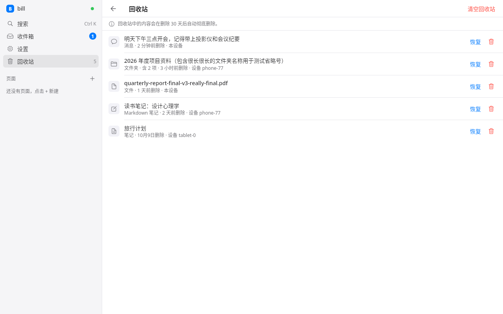

### v0.4：统一尺寸、字体和颜色

- 统一高度刻度 28 / 32 / 36 / 44 / 56，同一行元素等高居中；一套字体、5 级字号、3 种字重；中性灰阶加唯一强调色
- 320 到 1600+ 宽、托盘小窗、横屏、1.3 倍字号下都不溢出；删除可以撤销
- 检查清单见 [`docs/qa/v0.4-checklist.md`](docs/qa/v0.4-checklist.md)

| 浅色 | 深色 |
|---|---|
| 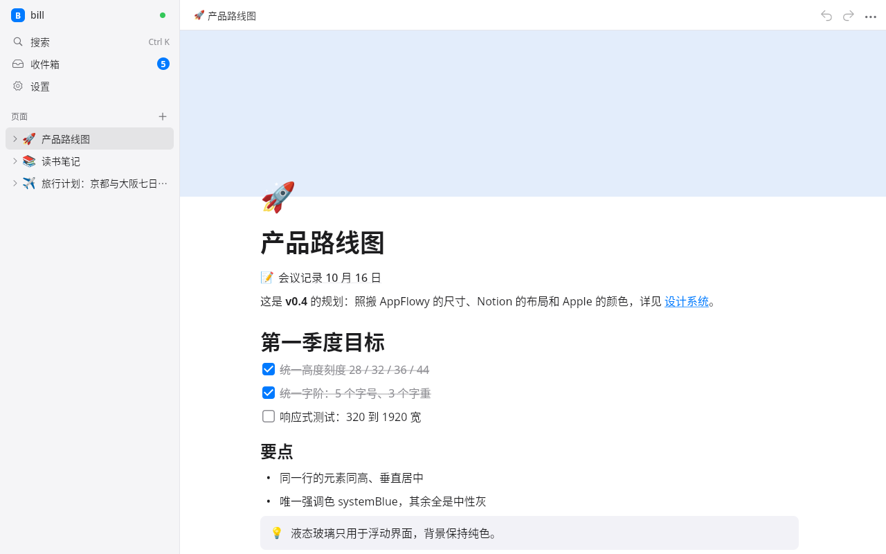 | 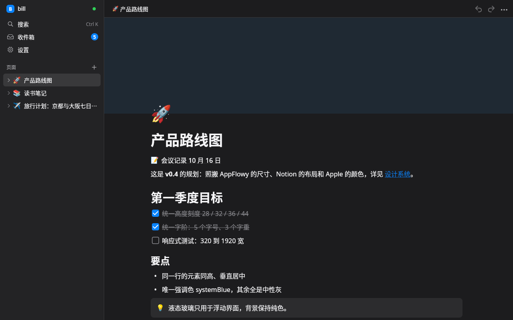 |
| 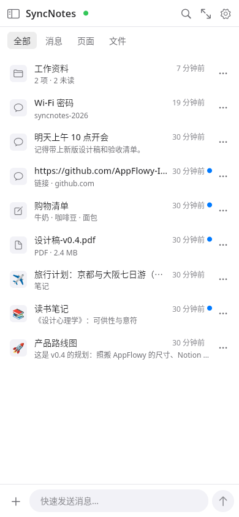 | 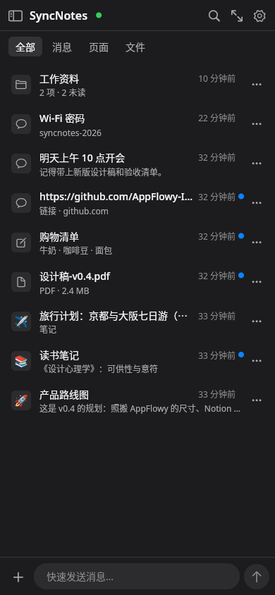 |

### v0.3：重做界面

- 统一的 Apple HIG 外观与 Notion 式布局：页面图标压在封面下沿、悬停手柄、斜杠菜单、浮动格式工具栏、快速查找
- 所见即所得：未编辑时隐藏 Markdown 标记；收件箱和搜索结果只显示纯文本
- 设计说明见 [`docs/design-system.md`](docs/design-system.md)

| 浅色 | 深色 |
|---|---|
| 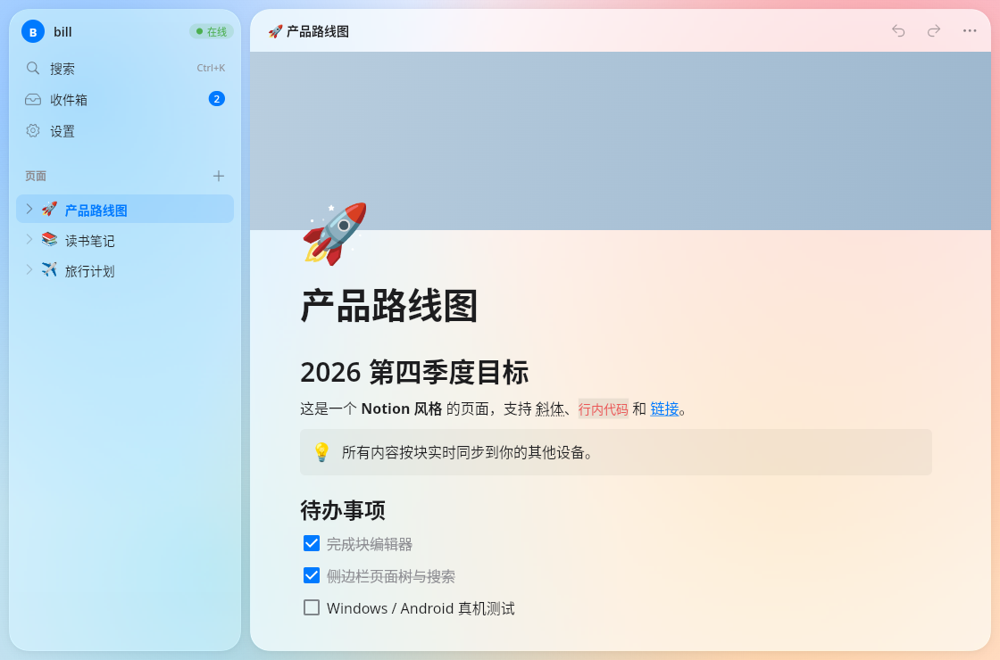 | 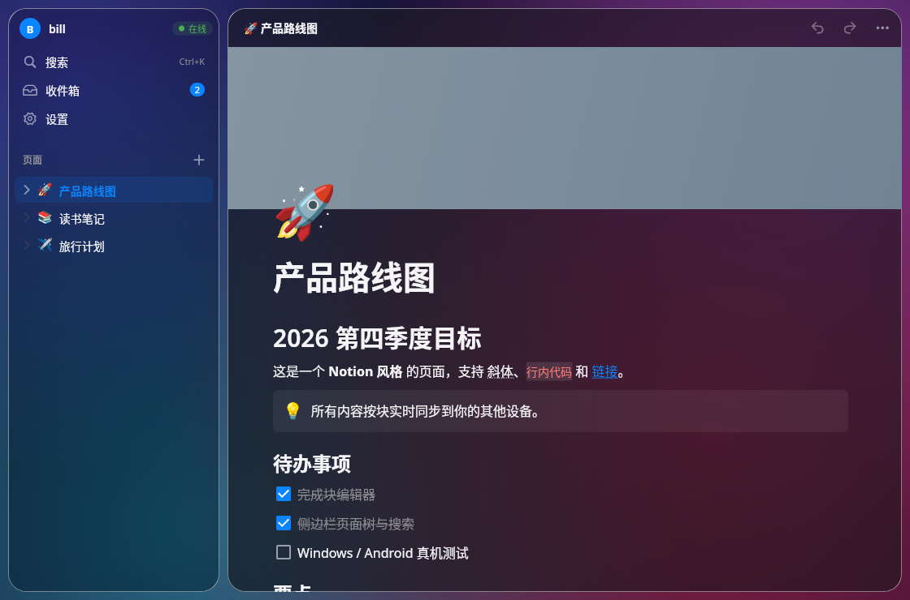 |

### v0.2：Notion 式页面

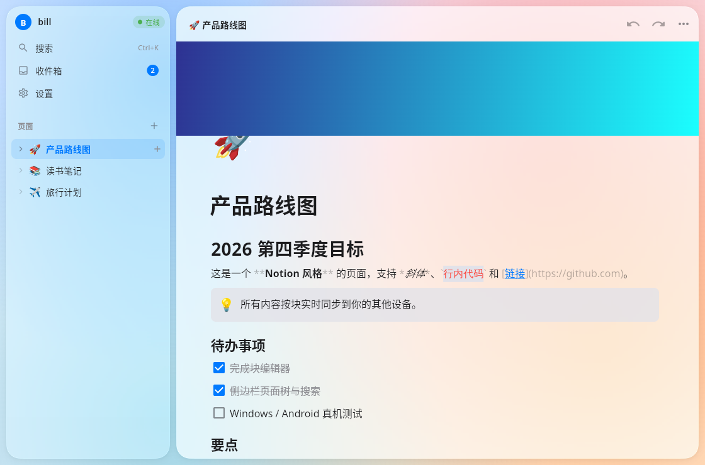

| 托盘小窗 | 深色模式 | Ctrl+K 快速切换 |
|---|---|---|
| 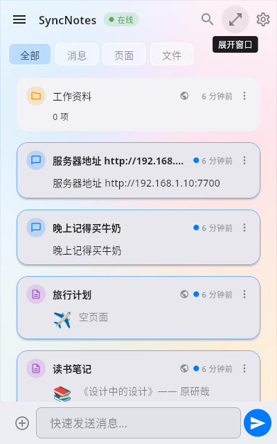 | 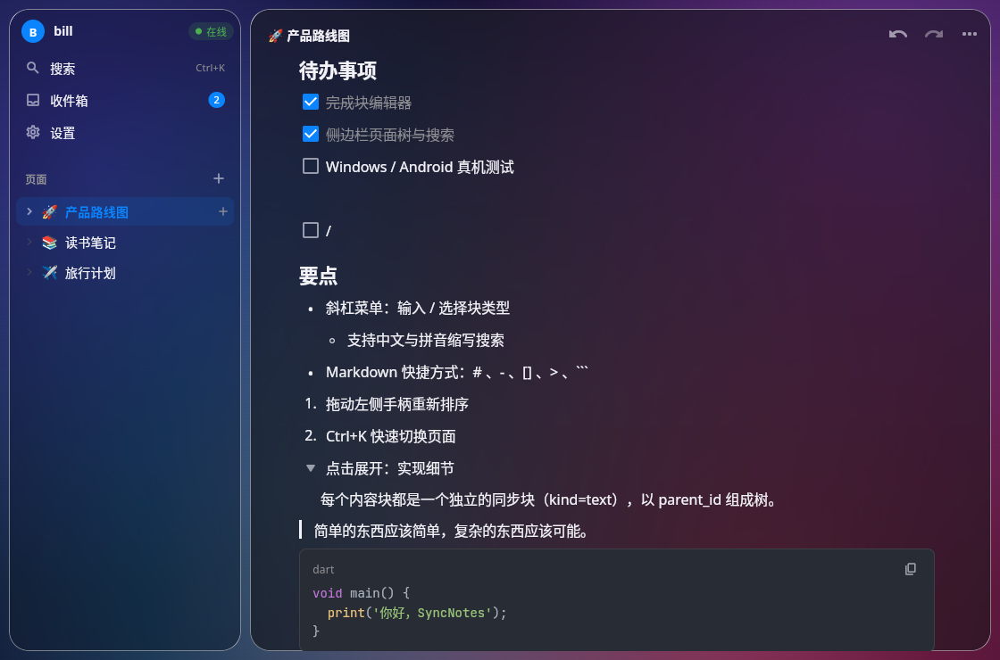 | 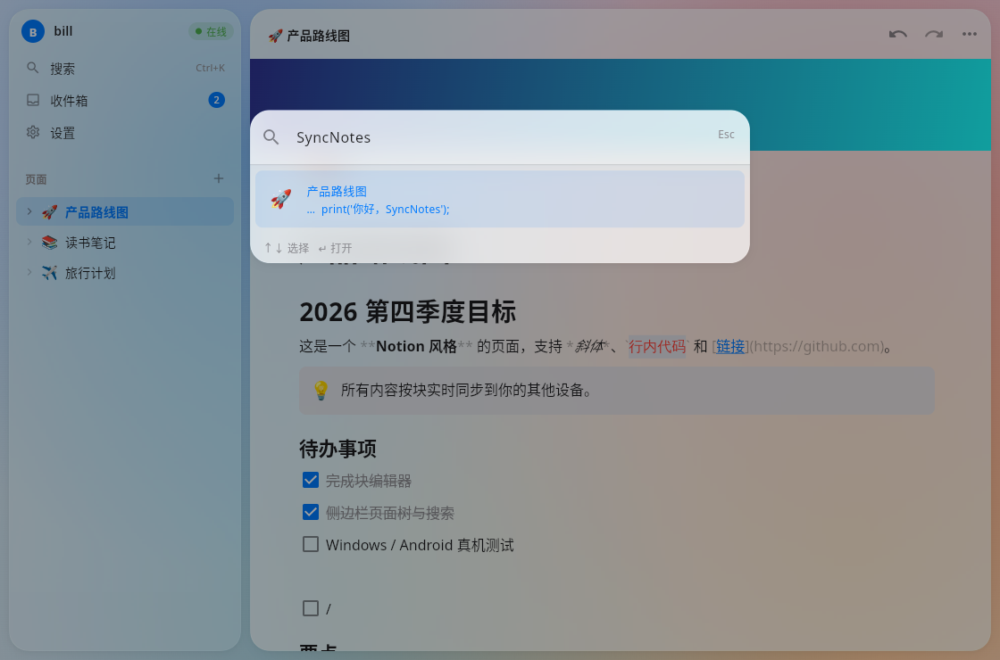 |

| 功能 | 说明 |
|---|---|
| 块类型 | 段落、一/二/三级标题、项目符号 / 编号 / 待办列表、折叠块、引用、提示框（callout）、代码块（语法高亮，30+ 语言）、分割线、图片、子页面 |
| 行内格式 | **粗体** `Ctrl+B`、*斜体* `Ctrl+I`、`行内代码` `Ctrl+E`、~~删除线~~ `Ctrl+Shift+S`、链接 `Ctrl+Shift+K` |
| 斜杠菜单 | 输入 `/` 弹出，支持中文、英文与拼音首字母搜索，↑↓ 选择、回车确认 |
| Markdown 快捷方式 | 行首输入 `# ` `## ` `### ` `- ` `1. ` `[] ` `> ` `` ``` `` `---` 自动转换 |
| 编辑 | 回车拆分 / 退格合并、Tab / Shift+Tab 缩进、↑↓ 跨块移动、拖动左侧手柄排序、撤销 / 重做（`Ctrl+Z` / `Ctrl+Y`） |
| 页面与导航 | 嵌套子页面、面包屑、页面图标与渐变封面、侧边栏页面树、`Ctrl+K` 快速切换器 |
| 同步 | 每个内容块独立同步，多设备同时编辑同一页面的不同块不会互相覆盖 |

### v0.1：基础功能概览

| 功能 | 说明 |
|---|---|
| 消息 / 笔记 / 文件 / 文件夹 | 快速发送消息、Markdown 笔记、文件上传下载、文件夹嵌套归类 |
| 已读状态 | 每个块可单独设为「按设备」（默认）或「全局」已读 |
| 实时同步与离线队列 | WebSocket 增量推送（LWW 冲突解决）；离线编辑持久化并在重连后合并重放 |
| 登录与局域网 | 用户名+密码登录签发令牌自动登录；支持局域网 IP 直连与 mDNS 自动发现 |

</details>

---

## 许可

MIT
