# SyncNotes 实时同步笔记 / 消息队列

一个可以自己部署的多设备实时同步工具：在任意一台设备上发消息、写笔记、传文件，其他设备**立即**看到。

- **客户端**：Windows / Linux / Android，同一套 Flutter 代码，Apple 风格 **Liquid Glass** 界面（基于设计规范的令牌系统，见 [设计系统](docs/design-system.md)）
  - **Notion 式笔记**：块编辑器、斜杠菜单、Markdown 快捷键、拖动排序、嵌套页面、侧边栏页面树、Ctrl+K 快速切换
  - 桌面端：系统托盘常驻，右下角小窗口，关闭即隐藏到托盘
  - Android：独立应用，前台服务保持长连接，新内容本地通知推送（无需任何付费推送服务）
- **服务器**：Rust 编写的轻量 WebSocket 同步服务（单个可执行文件 + SQLite），可部署在自己的服务器，也可以在局域网里直接运行（支持 mDNS 自动发现）
- **离线可用**：离线时的编辑会排队保存在本地，重新连上后自动重放同步

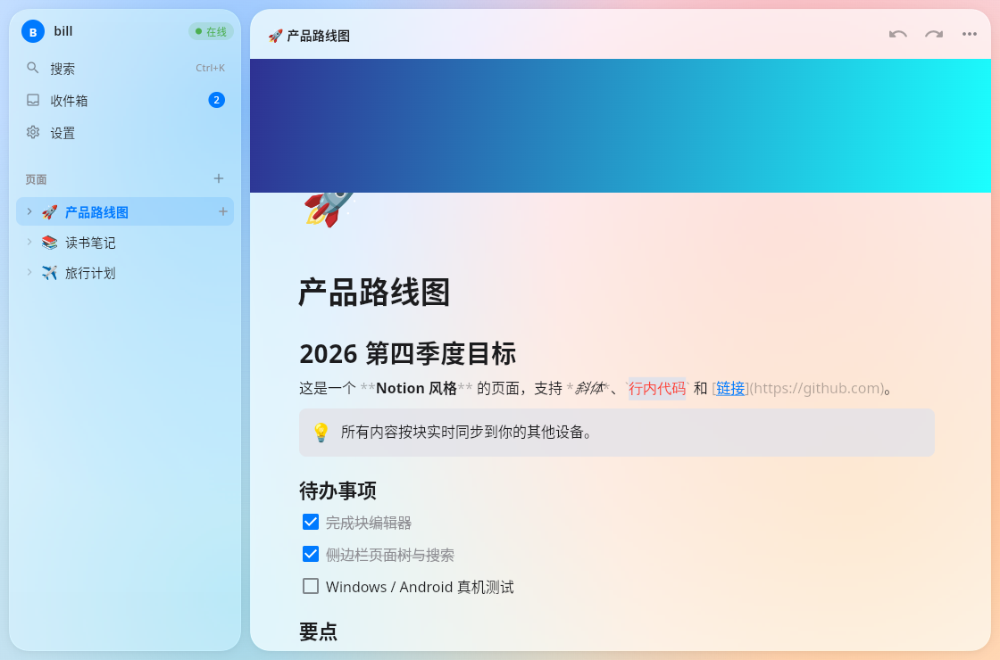

| 托盘小窗 | 深色模式 | Ctrl+K 快速切换 |
|---|---|---|
| 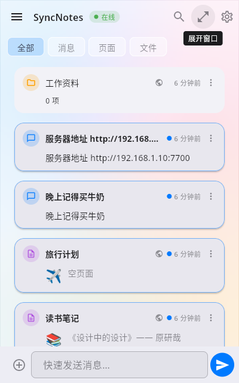 | 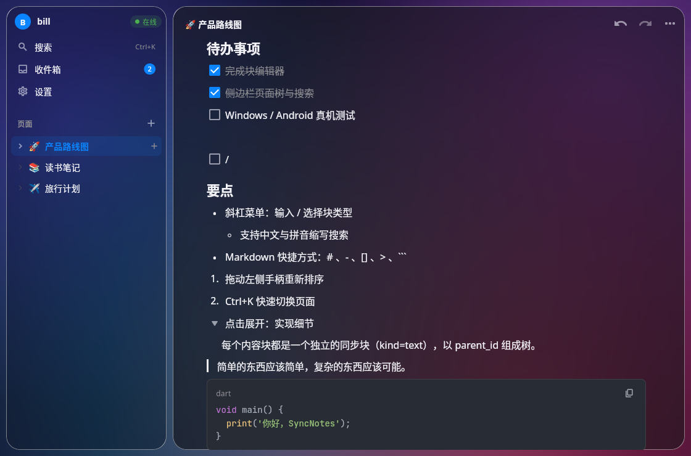 | 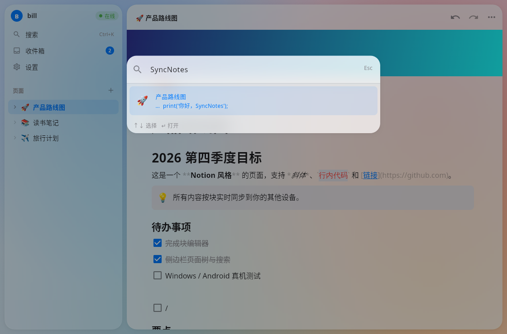 |

---

## 回收站（开发中）

- 删除的消息 / 笔记 / 文件 / 文件夹 / 页面先进入**回收站**，删除后的"撤销"提示条仍然可用（撤销 = 恢复）
- 侧边栏（桌面）和抽屉 / 设置页（Android）都能打开回收站：显示类型图标、标题、删除时间、删除设备；支持搜索、多选批量恢复 / 彻底删除、清空回收站
- 删除文件夹时，子项随文件夹一起进回收站，恢复后保持原来的结构；原位置已不存在时恢复到收件箱根目录并提示
- 服务器默认 30 天后自动彻底删除（`--trash-retention-days` / `SYNCNOTES_TRASH_DAYS`，0 = 永不），彻底删除时一并删除服务器上的文件内容
- 回收站中的内容不出现在收件箱、文件夹、搜索、通知和未读数里；删除、恢复、彻底删除在各设备间实时同步

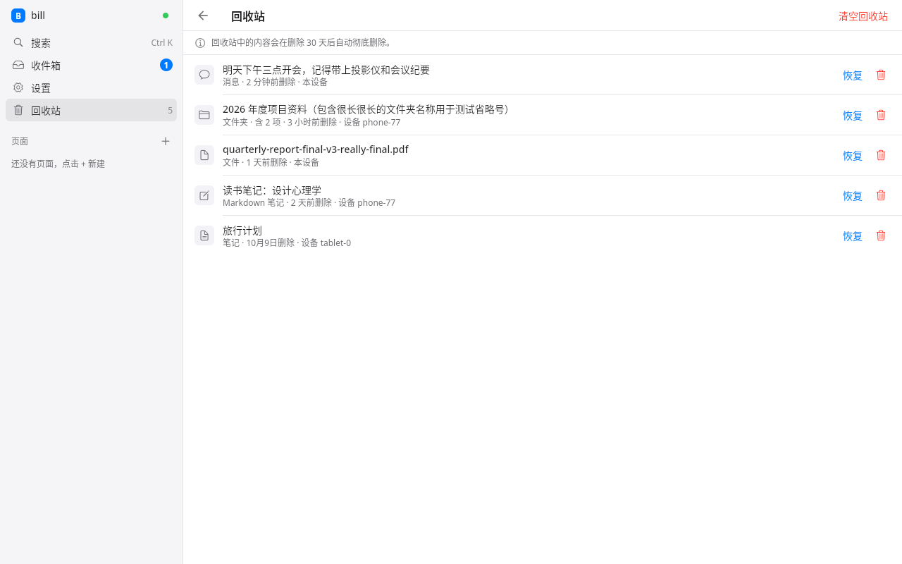

## v0.4：统一尺寸、字体和颜色

- 参考 AppFlowy 的尺寸刻度（只参考数值，未复制代码）、Notion 的布局和 Apple HIG 的颜色与控件
- 统一高度刻度 28 / 32 / 36 / 44 / 56，同一行元素等高居中；一套字体、5 级字号、3 种字重；中性灰阶加唯一强调色
- 320 到 1600+ 宽、托盘小窗、横屏、1.3 倍字号下都不溢出；删除可以撤销
- 检查清单见 [`docs/qa/v0.4-checklist.md`](docs/qa/v0.4-checklist.md)，截图见 `docs/screenshots/v0.4-*.png`

| 浅色 | 深色 |
|---|---|
| 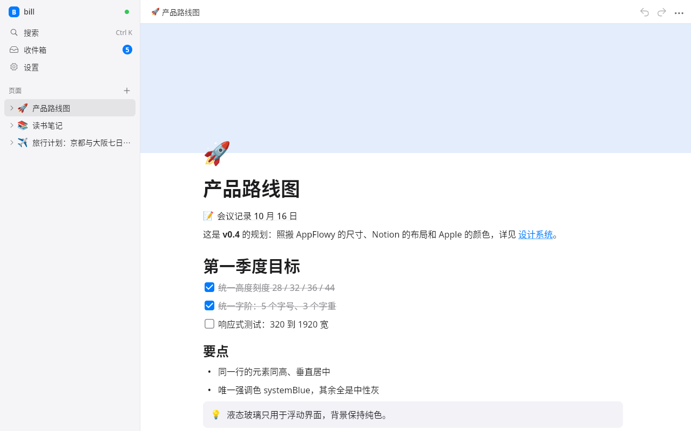 | 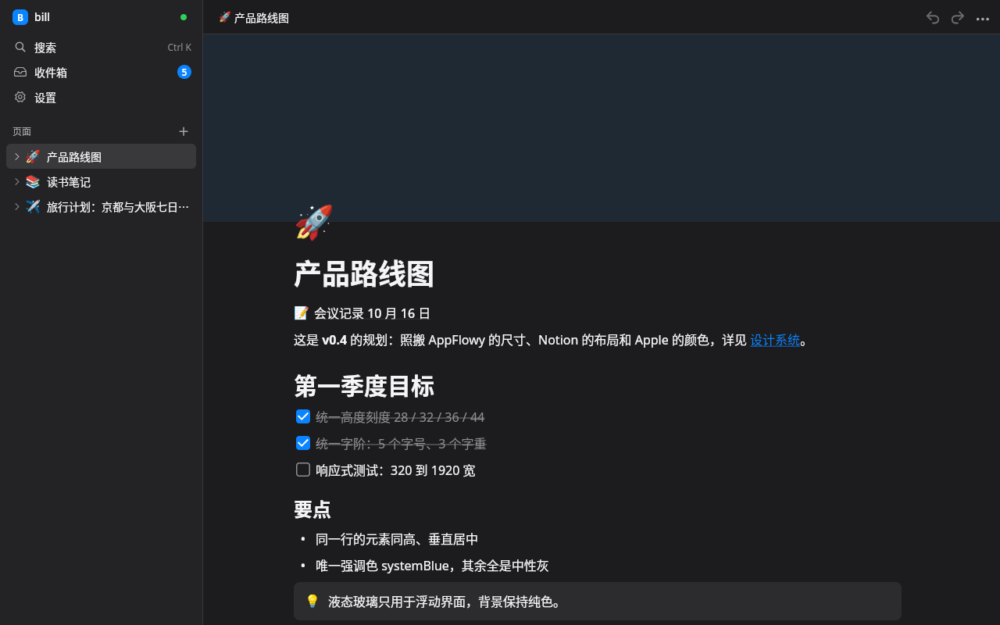 |
| 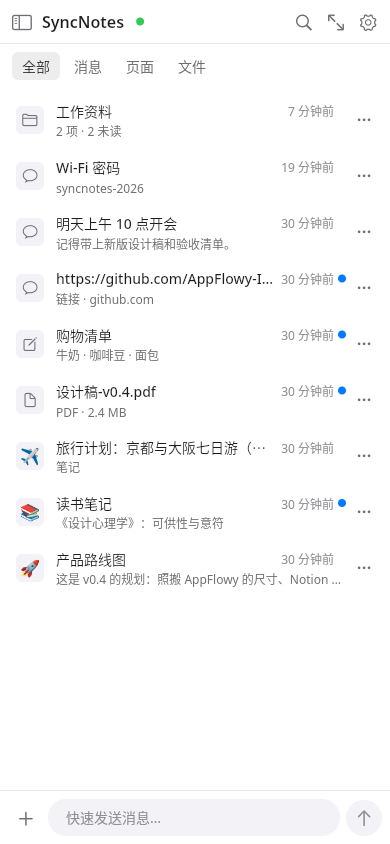 | 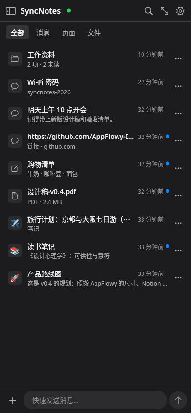 |

## v0.3：重做界面

- **统一的 Apple HIG 外观**：所有平台使用同一套系统色、字号层级、Liquid Glass 材质、SF Symbols 风格图标和弹簧动效
- **Notion 式布局**：页面图标压在封面下沿、Notion 字号比例、悬停手柄、斜杠菜单（H1/H2/H3 字形）、浮动格式工具栏、快速查找
- **所见即所得**：未编辑时隐藏所有 Markdown 标记；中文强调用点状下划线代替难看的合成斜体；收件箱和搜索结果只显示纯文本
- 重新设计的登录页（HIG 分组表单）、设置页（限宽居中、侧边栏正确高亮）、收件箱卡片
- 设计说明见 [`docs/design-system.md`](docs/design-system.md)（包括混用了哪些 Material / Fluent 规范及原因），截图见 `docs/screenshots/v0.3-*.png`

| 浅色 | 深色 |
|---|---|
| 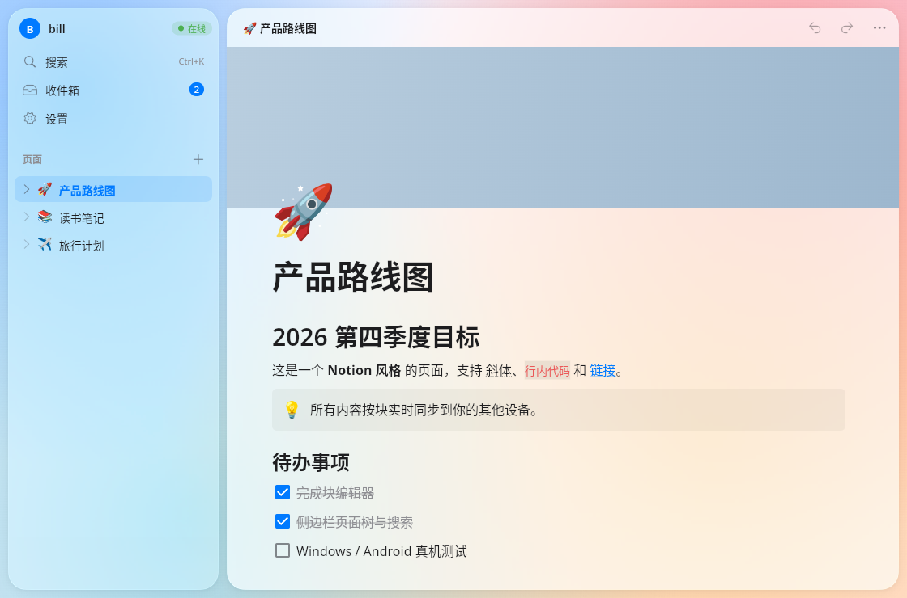 | 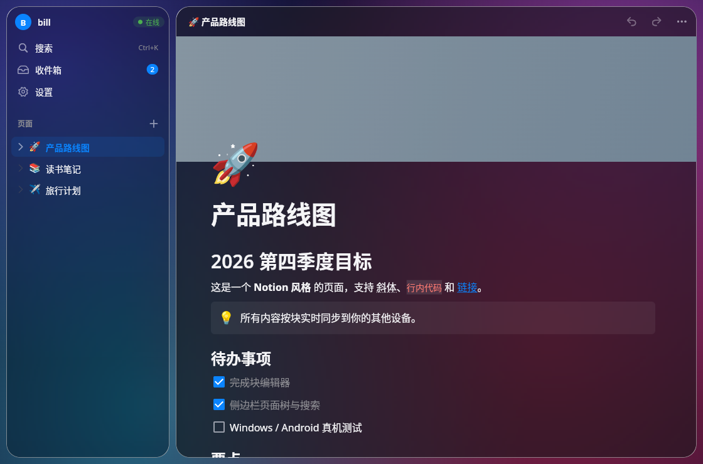 |

## v0.2 新功能：Notion 式页面

| 功能 | 说明 |
|---|---|
| 块类型 | 段落、一/二/三级标题、项目符号 / 编号 / 待办列表、折叠块、引用、提示框（callout）、代码块（语法高亮，30+ 语言）、分割线、图片、子页面 |
| 行内格式 | **粗体** `Ctrl+B`、*斜体* `Ctrl+I`、`行内代码` `Ctrl+E`、~~删除线~~ `Ctrl+Shift+S`、链接 `Ctrl+Shift+K` |
| 斜杠菜单 | 输入 `/` 弹出，支持中文、英文与拼音首字母搜索，↑↓ 选择、回车确认 |
| Markdown 快捷方式 | 行首输入 `# ` `## ` `### ` `- ` `1. ` `[] ` `> ` `` ``` `` `---` 自动转换 |
| 编辑 | 回车拆分 / 退格合并、Tab / Shift+Tab 缩进、↑↓ 跨块移动、拖动左侧手柄排序、撤销 / 重做（Ctrl+Z / Ctrl+Y） |
| 页面 | 嵌套子页面、面包屑导航、页面图标（emoji）与柔和渐变封面 |
| 导航 | 侧边栏页面树（展开 / 悬停新建子页面）、Ctrl+K 快速切换器（搜索标题与正文）、收件箱分类筛选 |
| 布局 | 宽屏（≥720）侧边栏 + 内容区；手机 / 托盘小窗使用抽屉；桌面端一键在小窗与大窗口间切换 |
| 外观 | 菜单和浮层使用液态玻璃，页面保持不透明（避免两页叠在一起）、浅色 / 深色 / 跟随系统 |
| 同步 | 每个内容块都是独立的同步块：多设备同时编辑同一页面的不同块不会互相覆盖 |

> 显卡较旧或在远程桌面中运行时，可设置环境变量 `SYNCNOTES_GLASS=0`，改用轻量的毛玻璃效果。

## 功能概览（v0.1）

| 功能 | 说明 |
|---|---|
| 消息块 | 底部输入栏快速发送；点击复制内容 |
| 笔记块 | Markdown 编辑 / 预览，自动保存，多设备实时同步 |
| 文件块 | 上传到自己的服务器，其他设备点击下载并用系统程序打开 |
| 文件夹 | 可包含其他任意块，支持移动块到文件夹，删除时连同子块一起移入回收站 |
| 已读状态 | **每个块可单独设置**：<br>· 按设备（默认）：每台设备独立记录已读/未读<br>· 全局：在一台设备上看过，所有设备都标为已读 |
| 实时同步 | WebSocket 推送；编辑冲突按"最后写入者获胜"处理 |
| 离线队列 | 离线编辑持久化到本地，重连后按顺序重放；同一块多次离线编辑合并为一次 |
| 登录 | 用户名 + 密码，服务端签发令牌，客户端保存令牌实现开机后自动登录 |
| 开机自启 | Windows（注册表 Run 项）、Linux（XDG autostart）、Android（开机自动启动后台同步服务） |
| 局域网 | 客户端直接填写局域网 IP:端口；登录页可一键搜索局域网服务器（mDNS） |
| 可扩展类型 | 每种块类型自己定义 显示 / 编辑 / 执行 行为，新增类型只需实现一个类并注册 |

---

## 一、部署服务器

服务器只有一个可执行文件，数据保存在一个 SQLite 文件和一个文件目录中。

### 一键管理脚本（Linux，推荐）

从下一个版本起，Linux 服务器压缩包里附带 `syncnotes-server.sh`（也可以从仓库的 `scripts/` 目录下载，和 `syncnotes-server` 程序放在同一目录）。解压后运行：

```bash
sudo ./syncnotes-server.sh            # 打开中文菜单：临时运行 / 持久运行 / 安装为服务并开机自启 / 停止 / 状态 / 更新 / 卸载
sudo ./syncnotes-server.sh install    # 直接安装为系统服务并开机自启（会逐项询问端口、目录等，回车用默认值）
sudo ./syncnotes-server.sh update ./syncnotes-server-v0.5.0-linux-x86_64.tar.gz   # 升级，失败自动回滚
```

脚本会自动找出旧的安装（旧的 systemd 服务、用 nohup 或手动启动的进程及其数据库），先备份数据库再迁移到 `/opt/syncnotes`。配置保存在 `/etc/syncnotes/syncnotes.env`。

**防火墙**：脚本从不自动修改防火墙。本机防火墙未启用时什么也不做，只提醒在云服务器安全组中放行端口；ufw / firewalld 已启用时才会询问，默认"不修改"；非交互模式只有加 `--open-firewall` 才会放行；卸载时只删除脚本自己添加的规则，并且先询问。

详细说明见 [`docs/server-script.md`](docs/server-script.md)。

**忘记密码 / 数据救援**（用户恢复码也丢了时，由管理员在服务器上执行，笔记数据不受影响）：

```bash
sudo ./syncnotes-rescue.sh reset bill                    # 密码重置为默认 syncnotes123456，用户登录后必须立即修改
sudo ./syncnotes-rescue.sh reset bill --password 新密码   # 或 SYNCNOTES_RESCUE_PASSWORD=新密码 sudo -E ./syncnotes-rescue.sh reset bill
sudo ./syncnotes-rescue.sh export bill bill.zip          # 导出全部数据（含回收站和附件）
```

用户自助找回（恢复码）和全部救援命令见 [`docs/password-recovery.md`](docs/password-recovery.md)。

### 方式 1：直接运行预编译文件（推荐）

到 [Releases](../../releases) 下载对应平台的服务器：

- `syncnotes-server-<版本>-linux-x86_64.tar.gz`（静态链接，适用于绝大多数 Linux 服务器）
- `syncnotes-server-<版本>-linux-aarch64.tar.gz`（树莓派 / ARM 服务器）
- `syncnotes-server-<版本>-windows-x86_64.zip`

压缩包内包含服务器程序、README 和 `deploy/`（systemd / Docker / Caddy 配置）。

```bash
tar xzf syncnotes-server-v0.3.0-linux-x86_64.tar.gz
cd syncnotes-server-v0.3.0-linux-x86_64
./syncnotes-server --bind 0.0.0.0:7700
```

数据不在这个版本目录里。普通用户是 `~/.local/share/syncnotes`，root 是 `/var/lib/syncnotes`，Windows 是 `%ProgramData%\SyncNotes`。目录里有 `syncnotes.db`、`syncnotes.db.seal`（传输加密密钥）和 `syncnotes-files`。如果当前目录里已经有旧的 `syncnotes.db`，第一次启动会把它复制过去，原文件保留。要用别的位置：`--db` / `--files-dir`，或环境变量 `SYNCNOTES_DATA`。

Windows：解压 zip 后运行 `syncnotes-server.exe`。数据同样在 `%ProgramData%\SyncNotes`，不在解压目录里。

启动后：

- 健康检查：`http://服务器IP:7700/health`
- WebSocket：`ws://服务器IP:7700/ws`

### 常用参数（也可用环境变量）

| 参数 | 环境变量 | 默认值 | 说明 |
|---|---|---|---|
| `--bind` | `SYNCNOTES_BIND` | `0.0.0.0:7700` | 监听地址 |
| `--db` | `SYNCNOTES_DB` | 见下方数据目录 | SQLite 数据库路径。指定后不再使用默认数据目录 |
| `--files-dir` | `SYNCNOTES_FILES` | 数据目录下的 `syncnotes-files` | 文件块的存储目录 |
| `--allow-register` | `SYNCNOTES_ALLOW_REGISTER` | `true` | 是否允许注册新用户。**建好自己的账号后建议设为 `false`** |
| `--trash-retention-days` | `SYNCNOTES_TRASH_DAYS` | `30` | 回收站保留天数，超过后自动彻底删除（含文件）；`0` = 永不自动清理 |
| `--mdns` | `SYNCNOTES_MDNS` | `true` | 是否在局域网广播 `_syncnotes._tcp` 服务 |
| `--mdns-name` | `SYNCNOTES_MDNS_NAME` | `SyncNotes` | 局域网广播名称 |

### 方式 2：systemd 常驻（Linux 服务器）

```bash
sudo useradd -r -s /usr/sbin/nologin syncnotes
sudo mkdir -p /var/lib/syncnotes && sudo chown syncnotes /var/lib/syncnotes
sudo cp syncnotes-server /usr/local/bin/syncnotes-server
sudo cp deploy/syncnotes.service /etc/systemd/system/
sudo systemctl daemon-reload && sudo systemctl enable --now syncnotes
```

### 方式 3：Docker

```bash
cd deploy
docker compose up -d --build
```

### 公网部署建议：加 HTTPS

在服务器前面放一个反向代理。Caddy 见 `deploy/Caddyfile.example`，Nginx 见 `deploy/nginx.conf.example`。也可以只打印配置、不改系统：

```bash
sudo ./syncnotes-server.sh proxy notes.example.com
```

代理必须转发 `Upgrade` / `Connection`（同步用 WebSocket），并且不要限制请求体、不要把整个文件缓冲完再转发（单文件最大 4 GB）。Caddy 默认就会转发 WebSocket。

客户端填域名时可以不写 `https://`，会自动补上。IP、localhost、`.local` 自动用 `http://`。已经写了 `http://` 或 `https://` 的保持原样。

传输使用应用层加密（syncnotes-seal-v1）：即使走普通 HTTP，密码、令牌、笔记和文件在线路上也是密文。明文只出现在发送端进程、服务器进程和接收端进程。`/health` 是明文，里面只有公钥。第一次连接会记住服务器公钥指纹，之后指纹对不上就拒绝连接。指纹用来确认还是同一台服务器，不表示硬盘上的笔记是密文。可以在设置里看加密经过哪些路径，也可以清除指纹后重连。HTTPS 仍然有用，它挡住第一次连接时的中间人。

上传和下载在侧边栏「传输」里看速度和进度，底部也会有一条细的状态。文件按 256KB 分块边读边传，同时最多两个任务。

### 局域网模式

在局域网任意一台电脑上运行服务器即可，客户端：

- 直接输入 `192.168.x.x:7700`；或
- 在登录页点击服务器输入框右侧的 📡 图标，自动搜索局域网中的服务器（mDNS）

Android 上若搜索不到，请直接手动填写 IP（部分路由器/系统会屏蔽组播）。

---

## 二、客户端使用

### 安装

到 [Releases](../../releases) 下载：

| 平台 | 文件 | 安装方式 |
|---|---|---|
| Windows | `SyncNotes-windows-x64.zip` | 解压后运行 `SyncNotes\syncnotes.exe`（已附带 VC++ 运行库） |
| Linux | `SyncNotes-linux-x64.tar.gz` | 解压后运行 `SyncNotes/syncnotes`（需要 GTK3；托盘需 `libayatana-appindicator3-1`） |
| Android | `SyncNotes-android.apk` | 允许"安装未知来源应用"后安装 |

### 首次登录

1. 填写服务器地址（如 `192.168.1.10:7700` 或 `https://notes.example.com`）
2. 第一次使用点击 **"没有账号？注册"**，输入用户名和密码 → **注册并登录**
3. 以后启动会使用保存的令牌**自动登录**，无需再次输入密码

### 日常使用

- **发消息**：底部输入框输入内容，回车或点 ➤ 发送
- **新建笔记 / 文件 / 文件夹**：点输入框左侧的 ⊕
- **点击块** = 执行该类型的主操作：
  - 消息：复制到剪贴板
  - 笔记：打开 Markdown 编辑器（编辑 / 预览两个标签页，自动保存）
  - 文件：下载并用系统默认程序打开（保存在 下载/SyncNotes 目录）
  - 文件夹：进入文件夹
- **长按 / 右键 / ⋮ 菜单**：编辑、标为已读/未读、切换"全局已读"、移动到文件夹、删除
- **未读标记**：未读块带蓝点并加粗；带 🌐 图标的块使用"全局已读"模式
- **顶部状态**：在线 / 连接中 / 离线（显示待同步数量）

### 设置

- **登录系统时自动启动**（桌面） / **开机自动启动后台同步**（Android）
- **启动时最小化到托盘**（桌面）
- **后台保持连接（前台服务）**（Android）：开启后通知栏会有一个常驻通知，保证新消息能及时推送
- **新内容通知**
- **新建块默认使用全局已读**
- 清除本地缓存并重新同步、退出登录

### 桌面端托盘

- 左键单击托盘图标：显示 / 隐藏窗口（窗口出现在屏幕右下角）
- 右键：显示窗口（含未读数）/ 退出
- 点击窗口关闭按钮只会隐藏到托盘，真正退出请用托盘菜单的"退出"

---

## 三、开发

```
syncnotes/
├── server/          Rust 同步服务器 (axum + tokio + SQLite)
│   ├── src/
│   │   ├── blocks.rs     块类型 / 已读模式定义
│   │   ├── protocol.rs   WebSocket 消息协议
│   │   ├── storage.rs    SQLite 持久化（LWW、序号、已读）
│   │   ├── sync.rs       WebSocket 处理 / 登录注册
│   │   └── files.rs      文件上传下载
│   └── tests/sync_tests.rs   端到端集成测试
├── app/             Flutter 客户端
│   ├── lib/
│   │   ├── models/       块模型
│   │   ├── blocks/       可扩展块类型注册表 + 内置类型
│   │   ├── sync/         同步引擎（离线队列、重连、增量追赶）
│   │   ├── platform/     托盘/窗口、自启动、通知、Android 前台服务
│   │   └── ui/           界面
│   └── test/             单元 / 组件 / 跨栈端到端测试
├── deploy/          Dockerfile、systemd、Caddy 示例
└── .github/workflows/build.yml   CI + 打 tag 自动发布
```

### 运行测试

```bash
# 服务器
cd server && cargo test

# 客户端（设置 SYNCNOTES_SERVER_BIN 后会额外运行"真实服务器 + 两个客户端"的端到端测试）
cd server && cargo build --release
cd ../app && SYNCNOTES_SERVER_BIN=../server/target/release/syncnotes-server flutter test
```

### 新增一种块类型

1. 服务器：在 `server/src/blocks.rs` 的 `BlockKind` 里加一个枚举值（旧服务器会把未知类型存为 `unknown`，不会报错）
2. 客户端：在 `app/lib/models/block.dart` 的 `BlockKind` 里加同名值
3. 实现一个 `BlockType` 子类（`buildPreview` 显示、`edit` 编辑、`execute` 执行），在 `registerBuiltinTypes()` 中注册

### 同步协议（简述）

客户端 → 服务器（JSON over WebSocket `/ws`）：

- `auth {token, device_id}`
- `upsert_block {id, kind, title, payload, parent_id, viewed_mode, client_updated_at, deleted}`
- `set_viewed {block_id, viewed}`
- `sync_since {since_seq}` — 断线重连后增量追赶
- `ping`

服务器 → 客户端：`auth_ok` / `auth_error` / `block_update {block}` / `viewed_update {block_id, viewed, device_id?, seq}` / `sync_complete {latest_seq}` / `error` / `pong`

每个用户有一个单调递增的序号 `seq`；每次变更都会分配新序号，客户端记录收到的最大序号，重连时只拉取之后的变更。删除分两步：移入回收站时设置 `deleted_at`（毫秒时间戳）和 `deleted_by`（设备 id，服务器填写），与其他字段一样按最后写入者胜出（LWW）同步、可离线排队；彻底删除使用墓碑（`deleted=true`），服务器会级联到所有子块并删除文件内容，保证离线设备也能收到删除。

协议兼容：`/health` 返回 `protocol: 2`、`features: ["trash"]` 和 `trash_retention_days`。`upsert_block` 中的 `deleted_at` 字段是可选的——旧客户端不发送该字段时服务器保留当前回收站状态（旧客户端编辑不会意外恢复或删除）；`null` 表示恢复，数字表示移入回收站。旧客户端会忽略 `block_update` 中的新字段（不会崩溃），但不认识回收站，会把回收站中的项目当作普通项目显示，建议同时升级客户端。旧数据库启动时自动加列迁移。

### 发布新版本

```bash
git tag v0.1.0 && git push origin v0.1.0
```

GitHub Actions 会自动构建 Windows / Linux / Android 客户端和三个平台的服务器，并发布到 Releases。

## 许可

MIT
